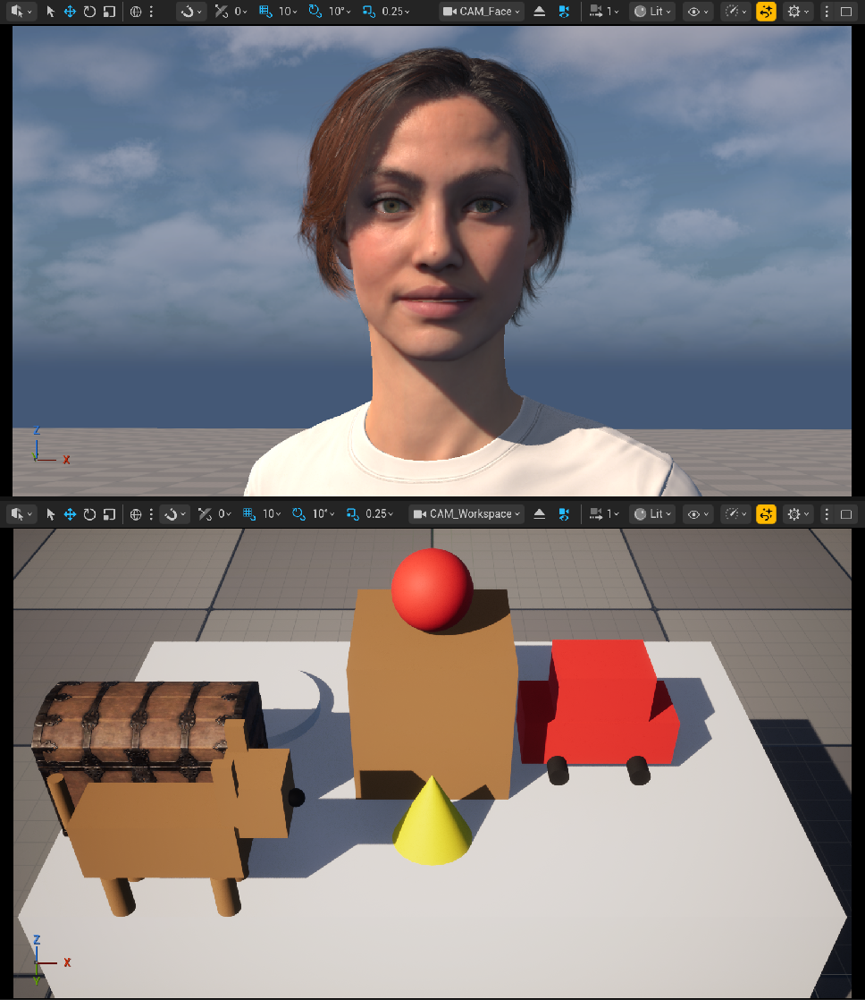

# Vivian: a talking AI game designer

Vivian is a realistic digital human, built in Unreal Engine 5.8 with MetaHuman during a one-day hackathon (10 October 2026). You talk to her through a microphone, and she answers out loud with lip-synced speech and facial expressions. She can also prototype game ideas on a 3D table next to her: placing shapes, building objects out of blocks, and bringing in a game-ready treasure chest.

**Demo video:** _add the link here_



## What she can do

- **Talk:** speak a question, and she answers in about 2.3 seconds with a natural voice.
- **Show feelings:** every reply has a mood (happy, sad, surprised, excited, playful, confused, confident or neutral) that shows on her face. She blinks, nods while she talks, and looks into the camera now and then.
- **Build on a table:** "put a red ball on the box", "build a small dog in front of the plate", "put a treasure chest right of the box". Objects appear in about 0.2 seconds.
- **Work with a human in the loop:** if one of her designs is off (say, a car whose wheels stand upright), you fix it by hand in Unreal and keep talking to her; built objects are real, connected parts, so your fix moves with them.

## How it works

```
You (mic) ─► Ears: Gradium speech-to-text (streaming, end-of-turn detection)
          ─► Brain: Google Gemini Flash-Lite (streaming reply + [mood] tag + [[action]] tags)
          ─► Voice: Gradium text-to-speech (48 kHz)
          ─► VB-Audio Virtual Cable ─► Unreal MetaHuman Audio Live Link ─► lip-sync on Vivian's face
                                       (your headset gets the same voice, delayed to match her lips)

[happy]                      ─► Python inside Unreal ─► her facial mood
[[place red sphere on box]]  ─► Python inside Unreal ─► the table changes (the tags are never spoken)
```

The Python bridge (`bridge/avatar_chat.py`) runs the whole loop and streams everything, so she starts speaking the first sentence while Gemini is still writing the rest.

## Tech stack

| Part | Tool | Its job |
|---|---|---|
| 3D character | Unreal Engine 5.8 + MetaHuman ("Vivian" preset) | Her face, hair and body |
| Lip-sync | MetaHuman Audio Live Link | Turns her voice into mouth and face movement |
| Ears | Gradium speech-to-text | Writes down your words, knows when you stop |
| Brain | Google Gemini Flash-Lite | Writes her reply, her mood and table actions |
| Voice | Gradium text-to-speech | Reads the reply out loud |
| Audio pipe | VB-Audio Virtual Cable | A virtual microphone that carries her voice into Unreal |
| Glue | Python (asyncio, websockets, sounddevice) | Connects everything and streams audio |
| Editor control | Unreal Python + Unreal MCP | Lets our code change the scene and the editor |
| Body language | Unreal Animation Blueprints | Blinking, nodding, looking at the camera |
| Remote mode | UDP audio over Wi-Fi | Talk to her from a second computer |
| 3D asset | Poly Haven "Treasure Chest" (CC0) | A game-ready, photoscanned prop |
| Coding partner | Claude Code | Wrote, tested and debugged the code with us |

## Measured latency

All numbers were measured during the hackathon on one Windows PC (i9-12900KF, RTX 3080 Ti). Details: [`unreal-integration/test_results.md`](unreal-integration/test_results.md).

| What | Time |
|---|---|
| End of your sentence → you hear her (median, 3 questions × 2 runs) | **2.26 s** (2.62 s before streaming) |
| End of your sentence → written reply, Gemini Flash-Lite vs Flash | **1.3 s** vs 3.3 s |
| Written sentence → her voice starts | ~0.1 s |
| Sound → her lips move (the headset voice is delayed to match) | 0.5–0.65 s |
| A place or build command on the table | 0.16–0.36 s |
| Editor frame rate while she talks | 86–115 fps |

One real turn, from the moment you stop talking: end of turn detected 0.64 s, text ready 0.95 s, reply starts 1.51 s, voice ready 1.66 s, sent to her face 1.74 s, heard in the headset 2.24 s.

## Challenges and fixes

| Problem | Fix |
|---|---|
| Building the MetaHuman needed more than a 16 GB MacBook | Moved to a Windows PC with an RTX 3080 Ti |
| Her skin came out grey | Turned on Shader Model 6 and rebuilt her |
| The editor crashed when our script runner re-entered a long job | One job at a time (a busy lock) |
| Her lips only opened and closed | 240 ms solver look-ahead + a captured "calm face" (lip closures 0.47 → 0.89) |
| Her voice came before her lips | Measured the face delay and delay the headset by the same amount |
| Slow answers | Stream sentence by sentence into the voice (2.62 → 2.26 s) |
| Faster end-of-turn settings cut people off mid-question | Kept the safe setting |
| Her body jumped with every mood change | The body stays calm; only her face shows emotion |
| Split screen: frozen pane, flickering hair, jagged shadows | Realtime on, hair locked to full detail, sharper virtual shadow maps |

## Repository layout

| Folder | What | Start here |
|---|---|---|
| `bridge/` | The voice loop, persona prompt and the table actions | [`bridge/README.md`](bridge/README.md) |
| `unreal-integration/` | Unreal project setup, MetaHuman, Audio Live Link, editor tooling (PyJobs, MCP), the table (`scripts/ue/workspace.py`), measurements | [`WINDOWS_HANDOFF.md`](unreal-integration/WINDOWS_HANDOFF.md), [`test_results.md`](unreal-integration/test_results.md) |

## Running it

You need Windows, Unreal Engine 5.8 with the MetaHuman plugins, VB-Audio Virtual Cable, Python 3.13, a headset, and API keys for [Gradium](https://gradium.ai) and Google Gemini.

1. Set up the Unreal project, Vivian and the Audio Live Link source as described in [`unreal-integration/WINDOWS_HANDOFF.md`](unreal-integration/WINDOWS_HANDOFF.md).
2. Copy `.env.example` to `.env` and fill in `GRADIUM_API_KEY` and `GEMINI_API_KEY`.
3. Install the bridge: `py -3 -m venv bridge\.venv` and `bridge\.venv\Scripts\pip install -r bridge\requirements.txt`.
4. Start the editor (`unreal-integration\scripts\launch_editor.ps1`), set the viewport to two stacked panes once, then run `powershell -ExecutionPolicy Bypass -File bridge\chat.ps1` and say hello.

## Not included

- **The Unreal project and the MetaHuman assets.** They are large and covered by Epic's MetaHuman license, so they are built locally with the steps above.
- **The treasure chest model.** Download Poly Haven's ["Treasure Chest"](https://polyhaven.com/a/treasure_chest) (CC0, by Rico Cilliers) as a 2k glTF and import it with `workspace.import_gltf(path)`.

## License

The code in this repository is released under the [MIT License](LICENSE). MetaHuman, Unreal Engine, Gradium and Gemini are products of their owners and are used under their own terms.
